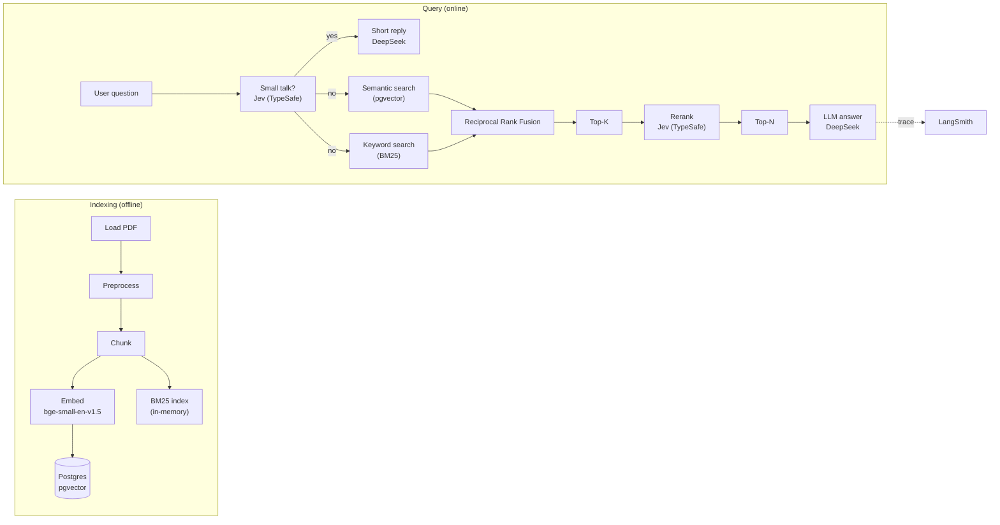
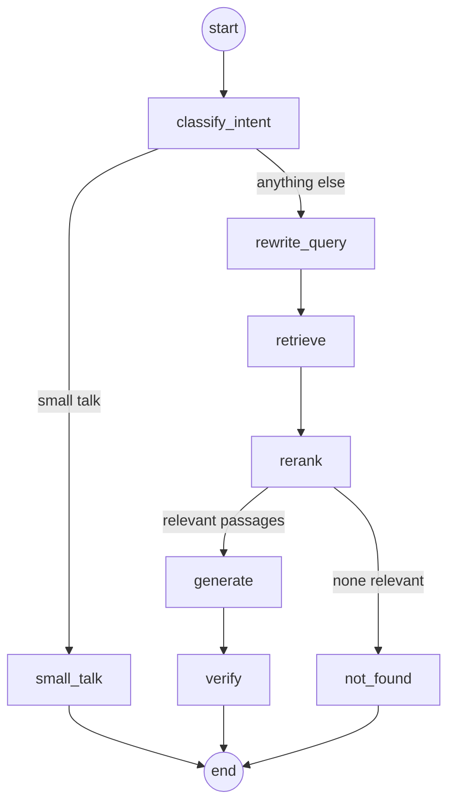

# Privy — Architecture

| | |
|---|---|
| Status | Draft |
| Last updated | 2026-11-09 |

How Privy is built. What it does is in [prd.md](prd.md).

## 1. Overview

One source of knowledge: the official GDPR text. The pipeline follows the classic RAG flow, with hybrid retrieval instead of vector-only search. Before it, Jev decides whether a message is small talk; small talk gets a short reply without retrieval (§2).

## 2. Graph

| Node | What it does | Code |
|---|---|---|
| `classify_intent` | Asks Jev whether the last message is small talk (a greeting, thanks, "what can you do?"). Only a probability of at least `MIN_SMALL_TALK` (0.9) counts; when unsure or when Jev is down, the message takes the retrieval path, because a real question answered without the regulation's text is worse than a greeting that goes through retrieval | `src/agent/intent.py`, `src/agent/graph.py` |
| `small_talk` | Replies to small talk with DeepSeek in one or two sentences, without retrieval and without citing the regulation. If the message also asks about another topic (Jev took it for small talk by mistake), it declines that part instead of answering from general knowledge | `src/agent/graph.py` |
| `rewrite_query` | Rewrites the last message into a standalone search query in the regulation's terms ("can I sue?" → judicial remedy, compensation; "who do I report it to?" after a breach question → breach notification). One small DeepSeek call | `src/agent/graph.py` |
| `retrieve` | Hybrid retrieval: BM25 + dense in parallel, fused with RRF, returns Top-K passages | `src/agent/retrieval.py` |
| `rerank` | Scores each candidate with Jev and keeps the Top-N that score at least `MIN_RELEVANCE`; if Jev is down, keeps the fusion order | `src/agent/reranking.py` |
| `not_found` | No passage is relevant: says the regulation does not cover the question, without calling the model | `src/agent/graph.py` |
| `generate` | Writes the answer with DeepSeek, grounded in the passages, with citations | `src/agent/graph.py` |
| `verify` | Checks that every cited article appears in a passage (as its label or referred to in its text). Otherwise rewrites the answer once; if it still cites something else, replaces it with an honest refusal | `src/agent/citations.py`, `src/agent/graph.py` |

The backend streams the model tokens of `generate` and `small_talk` (`ANSWER_NODES` in `src/backend/main.py`); the other model calls, such as the query rewrite, never reach the user. `not_found` and `verify` send their text on LangGraph's custom stream, so the backend can pass it on: a correction arrives as a `replace` event because the client has already seen the first version.

`retrieve` is an async node, so its first call loads the embedding model, reads the corpus for BM25 and imports the Postgres driver in a thread (`asyncio.to_thread`): all three read from disk, and doing that on the event loop would stall every other request. `langgraph dev` rejects such blocking calls outright.

The baseline (step 8) is a single `call_model` node; `retrieve` and `rerank` are added in step 11.

## 3. Retrieval pipeline

### Indexing

1. **Load**: read `corpus/gdpr.pdf` (or its extracted text `corpus/gdpr.txt`).
2. **Preprocess**: strip page headers, footnotes, and chapter/section headings; normalize whitespace. The text is split at "HAVE ADOPTED THIS REGULATION:" into recitals (before) and articles (after), because recital headers and Article 4's definition points look identical ("(1)") and only their position tells them apart.
3. **Chunk**: article-aware chunking — one chunk per article (or per recital). Article 4 gets one chunk per definition, cited as "Article 4(1)"; other very long articles are split into paragraph groups. The GDPR's natural unit is the article, so chunking follows it.
4. **Embed**: each chunk with `BAAI/bge-small-en-v1.5` (local, fastembed).
5. **Store**: vectors in Postgres with pgvector (HNSW index, cosine similarity); the same chunks feed the BM25 index.

### Query

1. **Hybrid**: the question is searched two ways in parallel — dense (embedding, cosine over pgvector) and sparse (BM25 over chunk tokens).
2. **Fusion**: Reciprocal Rank Fusion combines the two rankings; a chunk ranked high in both rises to the top.
3. **Top-K**: the fused top 20 (`TOP_K`) move to reranking.
4. **Rerank**: Jev scores each candidate's relevance to the question (probability), in parallel; the best 4 (`TOP_N`) that score at least 0.5 (`MIN_RELEVANCE`) go to the LLM.

## 4. How the agent runs (decision)

**Option A — the graph is called directly from our own backend.** A FastAPI backend imports the graph and streams answers; identity, threads, and the checkpointer are managed by the backend. Chosen because: one server, full control, easier to explain, and matches how the reference project is built. The LangGraph Agent Server is not used; `langgraph dev` and Studio are for development only. Everything runs on the local machine: Privy is a personal project and is not deployed to a server.

### Backend API

| Route | Sign-in | What it does |
|---|---|---|
| `GET /health` | no | Server is up |
| `POST /auth/register` | no | Create an account (password stored as an argon2 hash) |
| `POST /auth/login` | no | Exchange email + password for a JWT |
| `GET /me` | yes | The signed-in user |
| `POST /threads`, `GET /threads` | yes | Start a thread; list the user's threads |
| `GET /threads/{id}/messages` | yes | The conversation stored in a thread |
| `POST /threads/{id}/chat` | yes | Ask a question; the answer streams back as Server-Sent Events, and token usage is recorded |

The chat UI (`src/chat_ui/app.py`, Chainlit) is a client of this API like any other: it signs in through `/auth/login`, keeps the returned token in its session, creates a thread on the first question, and relays the streamed answer. It never imports the agent, so provider keys stay in the backend.

A thread's id is also the checkpointer's `thread_id`. Every thread route first checks that the signed-in user owns the thread and answers 404 otherwise, so another user's thread looks exactly like one that does not exist.

## 5. State

| Field | Meaning |
|---|---|
| `messages` | The conversation (LangChain messages, `add_messages` reducer) |
| `is_small_talk_message` | Whether Jev judged the last message to be small talk |
| `search_query` | The last message rewritten for retrieval |
| `documents` | Top-K passages from hybrid retrieval |
| `reranked` | Top-N relevant passages shown to the model |

## 6. Data stores

| Store | Holds | Used from |
|---|---|---|
| Postgres (Docker) | pgvector chunks with metadata; conversation checkpoints; app tables `users`, `threads`, `usage` (`src/backend/schema.sql`) | step 11 (vectors), steps 16–18 (app data) |
| BM25 index | In-memory token index over the chunks (LangChain `BM25Retriever`) | step 11 |

Postgres is the single real database; pgvector lives in it, so vectors and app data share one server.

## 7. Models

| Use | Model |
|---|---|
| Answers, query rewrite, small-talk replies | `deepseek-flash` (DeepSeek); `deepseek-v4-pro` if evaluation shows it is needed |
| Embeddings | `BAAI/bge-small-en-v1.5`, local through fastembed |
| Small-talk detection | Jev (TypeSafe), one yes/no probability question per message |
| Reranking | Jev (TypeSafe), via probability questions; retries for rate limits |

Jev rather than the rewrite call decides small talk because it returns a calibrated probability: the rule "when unsure, search the regulation" becomes a threshold in code, like `MIN_RELEVANCE` for reranking. It costs one extra Jev call on every message; small talk in return skips the rewrite, retrieval and up to 20 reranking calls.

## 8. Observability

Every run is traced in LangSmith (project `privy`). Retrieval and reranking runs are traced as child runs, so the quality of each stage can be inspected per question.

## 9. Evaluation

### 9.1 Practice corpus: FiQA (step 10, one-time)

FiQA is a **practice benchmark**, not part of the product. It is run once to learn and measure retrieval mechanics before the real GDPR corpus is indexed.

- **Why a benchmark at all** — measuring retrieval quality (NDCG@10) requires labeled ground truth: for each query, which documents are actually relevant. The GDPR text has no such labels.
- **Why FiQA** — FiQA is a standard BeIR benchmark with labeled query→document pairs. It happens to be about finance, but the topic is irrelevant: only the labels are used, to compare BM25 vs dense vs hybrid vs reranker. There is no standard labeled "GDPR Q&A" benchmark.
- **Where it lives** — `practice/fiqa/`, run with `uv run python practice/fiqa/evaluate.py`. It is not imported by `src/agent/`, not indexed, and not reachable from the product.
- **Result (200 queries, NDCG@10)** — bm25 0.136 · dense 0.363 · hybrid 0.287 · hybrid+rerank 0.412. The reranker is the biggest single win; naive 50:50 RRF pulled the fused ranking below dense on this paraphrase-heavy corpus, so hybrid's value is corpus-dependent.

### 9.2 Product evaluation: GDPR (step 13)

`evals/run.py` uploads `evals/gdpr_dataset.json` (23 questions: in scope, follow-ups, legal-advice requests, and questions the regulation does not cover) to the LangSmith dataset `privy-gdpr`, runs the real graph on each, and scores the answers against `prd.md` §12:

| Metric | How it is scored |
|---|---|
| `right_article` | Code: the answer cites at least one expected article |
| `no_invented_citations` | Code: the same check `verify` runs — every cited article appears in a passage |
| `honest_dont_know` | Code: for uncovered questions, the first sentence declines; correctly cited related context may follow |
| `relevance` | LLM judge (DeepSeek): the answer addresses the question, consistent with the reference notes |

A run costs API credit (about 70 DeepSeek and 460 Jev calls), so it is run deliberately, not in the test suite. These counts predate small-talk detection, which adds one Jev call per question. The dataset has no small-talk examples yet.

## 10. Open decisions

| Decision | Current value | Status |
|---|---|---|
| Top-K, Top-N, and the relevance threshold | `TOP_K = 20`, `TOP_N = 4`, `MIN_RELEVANCE = 0.5` (`src/agent/graph.py`) | **Not tuned** (roadmap step 23). These are the starting values from step 11. The step 13 evaluation passed with them, but no other values were compared. Tuning means running the evaluation for several combinations (e.g. Top-K 10/20/30, threshold 0.3/0.5/0.7) and keeping the cheapest one that still meets the targets; a lower Top-K also means fewer Jev calls per question. Each combination is one paid evaluation run. |
| Chunk size for very long articles (e.g., Article 83) | Articles over 1,600 characters are split into paragraph groups of about 1,200 (`src/agent/corpus.py`) | **Not tuned.** `OVERLAP_CHARS = 200` is defined but not used: parts do not overlap. |
| A cross-encoder as an alternative reranker, for comparison with Jev | — | **Not done.** |
| Small-talk threshold | `MIN_SMALL_TALK = 0.9` (`src/agent/intent.py`) | **Not tuned, not evaluated.** Needs small-talk examples in the evaluation dataset, including greetings mixed with a real question ("hi, can I delete my data?"), which must still take the retrieval path. |
| Small-talk check before or alongside the rewrite | Before: `classify_intent` runs, then `rewrite_query` | **Not measured.** Running both at once would hide Jev's latency on GDPR questions, but small talk would then still pay for the rewrite call. |
| Questions that need several searches (multi-article) | One search per question | **Not evaluated.** If the evaluation shows answers missing a second article, try query decomposition first; a ReAct loop only if that is not enough. |
