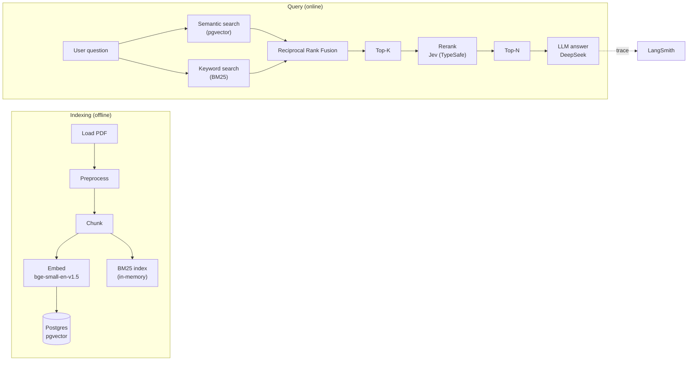
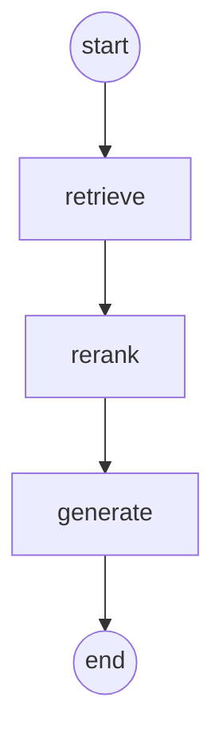

# Privy — Architecture

| | |
|---|---|
| Status | Draft |
| Last updated | 2026-10-18 |

How Privy is built. What it does is in [prd.md](prd.md).

## 1. Overview

One source of knowledge: the official GDPR text. The pipeline follows the classic RAG flow, with hybrid retrieval instead of vector-only search.

## 2. Graph

| Node | What it does | Code |
|---|---|---|
| `retrieve` | Hybrid retrieval: BM25 + dense in parallel, fused with RRF, returns Top-K passages | `src/agent/retrieval.py` |
| `rerank` | Scores each candidate with Jev, keeps Top-N | `src/agent/reranking.py` |
| `generate` | Writes the answer with DeepSeek, grounded in the retrieved passages, with citations | `src/agent/graph.py` |

The baseline (step 8) is a single `call_model` node; `retrieve` and `rerank` are added in step 9.3.

## 3. Retrieval pipeline

### Indexing

1. **Load**: read `corpus/gdpr.pdf` (or its extracted text `corpus/gdpr.txt`).
2. **Preprocess**: strip page headers and footnotes, normalize whitespace.
3. **Chunk**: article-aware chunking — one chunk per article (or per recital), with overlap only inside very long articles. The GDPR's natural unit is the article, so chunking follows it.
4. **Embed**: each chunk with `BAAI/bge-small-en-v1.5` (local, fastembed).
5. **Store**: vectors in Postgres with pgvector (HNSW index, cosine similarity); the same chunks feed the BM25 index.

### Query

1. **Hybrid**: the question is searched two ways in parallel — dense (embedding, cosine over pgvector) and sparse (BM25 over chunk tokens).
2. **Fusion**: Reciprocal Rank Fusion combines the two rankings; a chunk ranked high in both rises to the top.
3. **Top-K**: the fused top-K (default 20) moves to reranking.
4. **Rerank**: Jev scores each candidate's relevance to the question (probability), in parallel with retries for rate limits; the Top-N (default 3–5) go to the LLM.

## 4. How the agent runs (decision)

**Option A — the graph is called directly from our own backend.** A FastAPI backend imports the graph and streams answers; identity, threads, and the checkpointer are managed by the backend. Chosen because: one server, full control, easier to explain, and matches how the reference project is built. The LangGraph Agent Server is not used in production; `langgraph dev` and Studio are for development only.

## 5. State

| Field | Meaning |
|---|---|
| `messages` | The conversation (LangChain messages, `add_messages` reducer) |

Later: `documents` (retrieved passages) and `reranked` are added when the retrieval nodes arrive.

## 6. Data stores

| Store | Holds | Used from |
|---|---|---|
| Postgres (Docker) | pgvector chunks with metadata; later: accounts, threads, usage | step 9.3 (vectors), steps 11–13 (app data) |
| BM25 index | In-memory token index over the chunks (LangChain `BM25Retriever`) | step 9.3 |

Postgres is the single real database; pgvector lives in it, so vectors and app data share one server.

## 7. Models

| Use | Model |
|---|---|
| Answers | `deepseek-flash` (DeepSeek); `deepseek-v4-pro` if evaluation shows it is needed |
| Embeddings | `BAAI/bge-small-en-v1.5`, local through fastembed |
| Reranking | Jev (TypeSafe), via probability questions; retries for rate limits |

## 8. Observability

Every run is traced in LangSmith (project `privy`). Retrieval and reranking runs are traced as child runs, so the quality of each stage can be inspected per question.

## 9. Evaluation

The FiQA benchmark is used as a **practice corpus** to learn hybrid retrieval mechanics (BM25, embeddings, RRF, reranking) with labeled ground truth, before the real GDPR corpus is indexed. The GDPR evaluations then run in LangSmith with code-based and LLM-as-judge evaluators (roadmap step 17).

## 10. Open decisions

| Decision | Needed by |
|---|---|
| Chunk size for very long articles (e.g., Article 83) | step 9.3 |
| Top-K / Top-N defaults | step 9.3, tuned in step 17 |
| Whether to add a cross-encoder as an alternative reranker for comparison | step 9.3 tuning |
